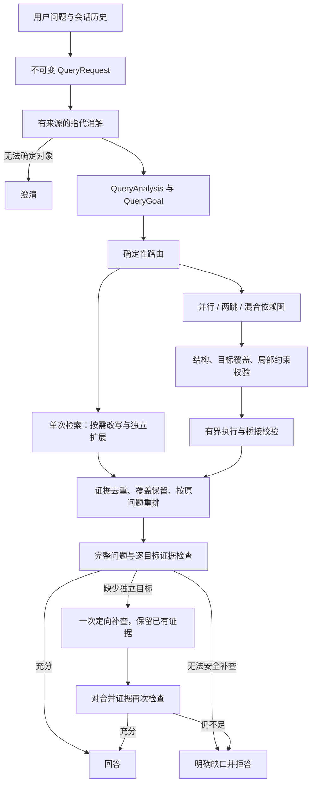
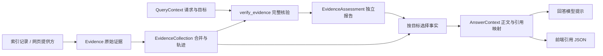

# 查询理解与执行管线（query-v5）

本轮改造把用户需求、语义目标、执行计划和证据判定拆成不同契约。工业化目标是：每次变换可追踪，子查询不丢条件，失败不丢已有证据，调用有预算，最终回答覆盖完整需求，并能通过真实 Agent 路径评测。

## 运行流程



Agent 的 `query` 只作为工具调用的检索提议和诊断信息；KB 管线以服务端绑定的原问题为准。它不能替换用户问题、用户身份或历史。多轮提议不会反复消解同一个指代或重新规划同一个原问题；缓存只在当前请求内生效。补查由目标和证据缺口驱动。Agent 重复同一工具参数会复用结果并以 `no_progress` 停止。

## 契约和模块

| 模块 | 职责 |
| --- | --- |
| `query_contract.py` | 原问题、消解后问题、参考日期、上下文来源、原文约束位置、稳定目标 ID |
| `query_grounding.py` | 检查目标约束是否增加原问题没有的明确条件；原文片段保留引文和位置 |
| `query_intent.py` | 语言特征、任务类型、目标列表、依赖和同次检索覆盖可能性；规则只能在明确场景提前返回 |
| `query_semantics.py` / `conf/query_domain.json` | 可版本化同义词、指标口径、比较方向和精确条件保护 |
| `query_validation.py` | 来源分句、目标局部约束、实体/指标/时间绑定和未知图表关系检查 |
| `query_rewrite.py` / `query_expansion.py` | 分别负责规范化与召回扩展；改写未发生也可扩展；失败回到可信输入 |
| `query_planning.py` | 路由与执行计划分离；校验节点、目标、模板、槽位、依赖和约束 |
| `query_execution.py` | 拓扑分层执行混合依赖图，保留成功分支和桥接失败前证据 |
| `query_runtime.py` | 请求级预算、进程级线程池与队列、模型调用记录、上下文传递 |
| `query_context.py` | 本轮显式共享的请求、指代消解和完整查询目标，不从工具诊断恢复业务状态 |
| `retrieval.py` | 集成执行、统一排序、目标补查与最终门控；保留门控前快照 |
| `domain/evidence.py` | 只读原始证据、来源与定位、检索轨迹、证据集合和回答引用映射 |
| `domain/facts.py` / `domain/assessment.py` | 财务事实契约、目标要求和绑定来源快照的核验报告 |
| `evidence_adapter.py` | 索引和解析器记录进入领域对象，以及领域对象输出为前端 JSON 的边界 |
| `retrieval_result.py` | 明确分开检索证据、候选证据、核验报告、澄清和运行诊断 |
| `evidence_pipeline.py` | 聊天与评测共用的最终核验、回答上下文、提示词格式化和引用输出 |
| `financial_facts.py` | 事实抽取、归属核验、逐目标匹配和事实正文投影 |
| `financial_fact_models.py` | 有界的复杂正文候选提取与独立关系核验 |
| `derived_evidence.py` | 从已核验财务事实或旧表格生成带输入出处的确定性计算证据 |
| `sequential_retrieval.py` | 从原文提取桥接值及来源；评级要绑定具体公司，冲突时放弃绑定 |
| `agent_evaluation.py` | 无数据库写入的真实 Agent → KB 工具 → 回答评测适配器 |

`QueryGoal.constraints` 保存按目标归属的约束；`source_spans` 必须逐字引用原文。服务端生成的 `constraint_provenance` 记录原值、规范化值，以及能在原问题中找到的原文引文和位置。原文中的片段直接接受，例如“贵不贵”或“贵”；改写过的约束允许使用不同说法，但不能新增公司、年份、数字等明确条件。主体、时间、指标等关系仍会检查，防止把已有年份或指标错绑到别处。只有上下文唯一时才解析“同期”。既有 `intent`、`language_features`、`task_types`、`need_expansion` 字段保持兼容。

不合格式但唯一的模型目标 ID 由服务端映射成合法 ID，并同步改写依赖引用；重复 ID、未知依赖和循环仍拒绝。有效目标清单中的数量和依赖是路由信号的依据，不因 `target_count=1, targets_independent=true` 这类冗余信号不一致而丢弃目标。映射及信号变化记录在 `normalization` 事件中。

规划最多 8 个节点，支持 `single`、`parallel`、`sequential`、`graph`、`clarify`。`sequential` 保留原来的两跳执行器；`graph` 支持独立目标和依赖目标混合。执行前拒绝循环、未知依赖、重复节点/槽位、非法格式模板、遗漏目标和适用约束。查询分析和规划各最多允许一次带校验原因的模型纠正，使用同一个请求预算；网络异常不触发此纠正。输出截断时，第二次调用可提高输出 token 上限，最高 4096。

有效独立目标优先直接编译为并行查询，并通过完整结构和语义校验，`source=rule` 且没有 `fallback_reason`。只有编译失败才请求模型生成计划，不再为每次并行查询固定多调用一次模型。模型仍失败后不重复相同的失败编译。依赖目标必须提供真实槽位；无法生成合格计划时回退原问题单次检索。带输出槽位的排名查询若仅缺少已验证目标的“最高/最多”等选择条件，服务端补入该条件，桥接仍须从证据取值，不能预设获胜类别。没有把“未来三年”等相对时间自动展开为具体年份。

关系检查在分析和规划阶段都执行。对于“图2和图3中，哪张图对应某事实”，目标必须保留待求关系，不能按提及顺序提前指定图号；还检查显式主体与年份、指标与报告期、固定图号与指标，以及光伏等业务范围的归属。这些是有边界的确定性检查，并非通用自然语言关系推理器。原问题与自身的保真校验必须通过；组织提取先隔离时间文本，不通过删去名称中间的时间来拼造实体。

对于明确列出 2–8 个图表候选的未知对应关系，规则保留一个完整关系目标和 `candidate_locators`，为每个候选编译读取节点，不向节点预填待求事实。最终合并优先保留各候选图表命中的证据，充分性校验仍检查完整原问题；缺少候选时只补查未覆盖的图表定位，并保留共享主体范围。不能仅凭“已取回两个标题”视为关系已经解答。

同义词表只应收录经业务确认的等价表达。基本/稀释每股收益、净利润/归母净利润、实际/预测、累计/新增、金额/费用率不应相互替换。确定性保护也检查正负号、比较符和显式比较方向。当前实体识别以中文组织、引号、少量人名/地点模式为主，不是通用 NER 或完整语义等价证明。

指代消解只接受带历史原文和消息索引的替换绑定，不接受模型改写整个问题。助手独自提出、用户从未提供的实体不会直接成为硬事实。信息不足返回澄清；这属于保守策略，可能增加澄清率，应在真实会话集上评估。

## 证据闭环与失败行为

- 独立节点并发，后继等依赖完成才执行。父节点失败或没有可靠桥接值，只阻断其后继，已完成兄弟节点仍保留。
- 需要继承文档范围时，必须取得明确的同一文档 ID；缺失或冲突时阻断，不扩大范围。
- 模型必须逐目标报告 `supported`、`missing` 或 `conflict`，并给出有效来源索引。目标缺失、重复 ID、越界索引、总判定和目标判定矛盾均视为校验失败。
- 缺少独立目标时最多补查一轮。保留已支持证据，合并新候选后重新检查完整问题；没有新证据立即停止。依赖子图的自动重规划尚未实现，不能把未取得的桥接值当作已知事实补查。
- 校验器故障默认拒答，不把故障误判为缺少某项事实并无限重试。`RAG_EVIDENCE_SUFFICIENCY_FAIL_OPEN=true` 或关闭语义门控会改变这一保证；公司财务数值仍须通过事实门控。
- 超时、连接错误、HTTP 408/5xx 最多重试一次，仍受原请求期限与模型调用预算约束；格式或语义错误不按网络故障重试。失败保留 `verification_status=unavailable`、`failure_kind`、`failure`、`attempts`，回答文案区分“未完成核验”和“资料不足”。
- 计算结果无需在文档中原样出现。白名单计算当前覆盖同一期间的每股派息率、显式两期同一指标的差值和增幅/降幅，以及绑定各公司操作数的同期间跨公司差值；使用 `Decimal`，不执行模型表达式。输入检查实体、时间、单位、冲突及分母。派息率可以使用同一表内、未标出不同单位的两项每股指标作为共同计量基础，并记录 `unit_basis`；不跨文档猜币种或做未经支持的换算。
- `derived_evidence` 保存输入、公式操作、结果和来源 chunk；门控使用时返回 `derived_evidence_ids`，财务计算另外记录 `input_fact_ids`。不支持或输入不足的自动计算记录 `unresolved`；公司财务计算不能放行缺少可比核验输入的目标。其他目标仍由语义门控判断。计算成功也不替代其他事实、关系及目标的充分性检查。
- Agent 合并多次 KB 调用或其他工具结果时，再检查整个证据集合；会话临时文档也参与这一检查。充分性失败时不调用回答模型。最终判定会传给评测结果。

## 证据结构与应用边界

业务流程使用明确的领域类型。证据核验始终传递 `EvidenceCollection`；来源 JSON 只在索引及外部检索入口适配，模型请求和 API 输出在各自出口序列化。目标覆盖、事实出处和计算结果中的字典是报告数据，不是原始证据的中间表示。



- `Evidence` 保存稳定标识、原文、`EvidenceSource`、`EvidenceLocation` 和 `EvidenceStructure`。原文和嵌套来源结构只读，来源适配时复制，后续修改原始字典不会改变证据。来源适配器一次性解析为 `EvidenceTable`、`EvidenceTableRow`、`EvidenceFigure` 和 `EvidenceAttribution`，财务规则及派生计算直接读取这些类型；原始行和列映射用于证明切片来自原表。解析器附加字段只为模型及 API 输出保留。`financial_facts`、`answer_context` 等本次查询的判定不写回原始证据。
- `EvidenceCollection` 内部按 ID 索引并维持顺序；排序分数和不同查询的命中记录放在 `RetrievalTrace`，不改变证据身份。相同 ID、相同来源只保留一份原文并合并轨迹；相同 ID 对应不同原文、来源或定位时保留首份来源并记录身份冲突，最终核验拒绝使用该集合。
- `EvidenceAssessment` 是检索、工具和回答阶段共用的唯一核验报告，直接保存 `sufficient`、`reason`、`missing_requirements`、目标覆盖和结构化 `facts`，不再嵌套另一个判定对象。支持事实 ID 和计算结果从 `facts` 取得，只保留一份权威数据；重试次数、故障详情放入报告的 `diagnostics`。报告绑定完整查询、证据集合、规则版本和实际核验模式，只有范围及模式一致且报告自身未变化时才复用。新增会话文档、合并新证据、目标或规则变化都会重新核验；跳过语义检查的报告不能用于要求语义检查的路径。候选来源的核验顺序在结果组装和工具合并时保留，重复命中只新增轨迹时可以复用。已绑定报告不能直接改绑到新范围。报告保存独立快照，抽取阶段的状态变更不会修改已完成报告。
- `evidence_verification.py` 的 `verify_evidence` 是完整核验入口，只接收当前 `QueryContext` 和 `EvidenceCollection`，目标统一从上下文读取。它组织身份冲突检查、报告复用、一次财务事实核验和充分性评估，最后绑定报告范围。`evidence_sufficiency.py` 的 `assess_evidence_sufficiency` 只消费现成事实报告，返回尚未绑定范围的结果，不再次抽取、不创建查询上下文，也不依赖完整核验模块。`evidence_assessment.py` 的 `finalize_assessment` 只绑定范围及模式，不隐式执行业务核验。
- 模型输入通过 `VerificationItem` 引用原始 `Evidence`，筛选和裁剪正文不会重建来源。只有发送请求时生成 JSON；输入序号按实际发送顺序生成，计算操作数通过稳定来源 ID 映射到模型序号。财务模型上下文只包含已选择事实，原始混合公司表格留在引用审计数据中。
- `AnswerContext` 只保存筛选后的正文、使用的事实 ID 和一份连续引用映射。格式化提示词和生成前端引用都消费这份结果，不再分别筛选或重新抽取事实。不适用来源不会占用最终引用编号，原文仍可通过引用查看；核验不通过或报告失效时禁止构建回答上下文。

`ToolResult` 表达一次工具执行，显式包含 `evidence`、`candidates`、`assessment`、`clarification` 和 `diagnostics`。`content` 是供检索决策器观察的工具摘要，最终回答从 `AnswerContext` 取得支持正文。`AgentRun` 记录工具执行循环；`AgentExecution` 持有最终证据集合、核验报告、回答上下文和流。这三个类型的职责不同，保留各自边界。旧 `ToolSource`、`_PreparedEvidence` 和工具结果转字典列表的中间转换已经移除。

`QueryContext` 由当前请求创建，通过服务端工具调用显式共享，保留 `QueryGoal` 的 `source_spans`、`constraint_provenance` 和 `candidate_locators`。工具中的搜索词不替换用户问题，`diagnostics` 不能重建或覆盖当前请求。`retrieve_evidence` 是统一检索入口，返回 `RetrievalResult`；聊天、知识库单轮评测、Agent 评测和纯检索评测都直接消费该类型。结果显式保存候选总数及检索时的类型化请求、查询分析，`retrieval_record` 只在评测及 API 输出边界生成 JSON，并保留排名分数和运行诊断。结果中的查询信息用于输出快照，不能替换当前调用方持有的 `QueryContext`。结果组装只验证已有报告范围，不补核验或补绑定。显式注入的外部检索器和历史记录通过 `adapt_retrieval_records` 进入相同类型；JSON 中的判定没有可信核验范围，适配器将完整来源交给 `verify_evidence` 重新核验，不自行执行财务判断。补查保留检索排序所需的原始记录，新候选在入口适配后以完整集合重新核验。各回答入口共用 `evidence_pipeline.py` 构建回答上下文及引用，该模块不执行核验；会话临时文档在合并阶段加入一次。

## 财务事实归属与回答上下文

`financial_facts.py` 为公司财务数值目标编译 `FactRequirement`，并从可信表格和明确正文关系生成独立的 `FinancialFact`。归属核验、事实有效性与目标适用性分开记录。事实保存原始数值、十进制规范值、单位、币种、实际/预测、合并/母公司、业务范围及原文位置；缺失口径保持 `unknown`。模型或工具传入的 `verified` 标记不能充当核验结果。

表格扩展保留每行自己的归属、完整来源行和原始列映射。公司行、公司列根据这一行的结构重新核验；无公司名称的指标表须有正文中的明确报告主体和财务报表章节依据。主体证明可来自明确标签，或报告开头公司名称与已登记证券代码一致的标题。文件名不能单独确认数值归属。新增标题证明使用 `entity-attribution-v2`，旧资料需要重新解析才能获得该证明；已有明确标签和公司行仍可核验。视觉模型重建但没有独立结构证明的表格保持未知。明确的简单正文和严格有序的“分别”关系使用规则核验；复杂关系默认保持未知。

`RAG_FINANCIAL_FACT_MODEL_ENABLED=true` 时，复杂正文缺少事实支持才使用模型提取候选，再以独立调用核验关系。候选须通过原文位置、公司登记、指标、期间、数值和单位校验；明确规则关系优先于模型的相反配对。核验结果只保存在当前请求的服务端缓存中，并绑定原文摘要及实体表版本，不能通过工具元数据重放。两次调用使用现有期限和调用预算，失败后保持未知。该路径默认关闭，启用后仍需用真实语料校准模型核验准确率。

核验报告通过 `facts` 保存财务事实和计算结果，通过目标覆盖记录逐目标事实引用。`financial_fact_bundle`、`supporting_fact_ids` 等兼容字段只在 JSON 输出时生成，正常业务流程不再序列化后重新解析。历史报告内容可以由 `evidence_adapter.py` 解码，但解码结果不能直接充当当前请求的有效报告。未匹配事实标为 `not_applicable`，不会单独导致其他目标拒答；归属不足保留未知，口径明确且可比时才确认值冲突，未知口径或近似披露造成的不同值记录为信息不足。计算消费核验事实，使用 `Decimal` 并记录 `input_fact_ids`；未知口径只允许在同一可靠表格有共同计量依据时使用，不跨独立来源猜测可比性。

回答保留完整原文用于前端引用，服务端通过 `AnswerContext` 单独生成支持正文；前端协议仍输出 `answer_context` 字段。其中只含匹配事实、核验后的计算及不含数值的必要解释；审计用的完整表格和混合公司引文不会重新交给回答模型。最终回答入口对 KB、工具合并、会话文档统一执行事实门控，并保留目标契约。财务目标使用消解后的问题，不把历史回答中的数值当作本轮证据。关闭充分性模型或设置 fail-open 不能绕过财务归属门控。

第一版覆盖已登记或明确命名公司的财务数值目标，以及有可靠报告主体的财务表。未登记公司不自动创建实体；没有公司目标但候选中存在公司范围时需要确认主体。未消解的相对期间和未逐年展开的年份范围保持未知，规划模型不能只用端点年份代替完整要求。完全不含实体或主体元数据的旧证据仍由现有充分性策略处理。原因、评级和非财务目标沿用现有语义门控；含明确数值的原因问题仍执行事实核验。生成后的公司—事实—引用一致性检查尚未实现。

## 预算、并发和回滚

默认值见 `backend/.env.example`：

| 配置 | 默认值 | 含义 |
| --- | --- | --- |
| `RAG_QUERY_DEADLINE_SECONDS` | 45 | 当前请求的规划与 KB 检索期限 |
| `RAG_QUERY_MAX_MODEL_CALLS` | 16 | Agent 规划、消解、意图、规划、改写、扩展、桥接、校验共享次数 |
| `RAG_QUERY_MAX_RETRIEVALS` | 12 | 各节点和补查共享的逻辑检索次数，缓存命中不消耗 |
| `RAG_QUERY_CONCURRENCY` | 3 | 单次请求同一波的最大并发数 |
| `RAG_QUERY_WORKERS` | 8 | 单进程共享线程池大小；提交槽位限制为两倍线程数 |
| `RAG_QUERY_GRAPH_ENABLED` | true | 关闭后混合依赖图回退原问题检索 |
| `RAG_QUERY_REPAIR_ENABLED` | true | 允许一次缺失独立目标补查 |
| `RAG_EVIDENCE_SUFFICIENCY_TRANSIENT_RETRY` | true | 允许一次预算内的证据校验网络故障重试 |

关闭并行或递进检索也会关闭依赖这些能力的混合图。`QUERY_REWRITE_ENABLED` 和 `QUERY_EXPANSION_ENABLED` 各自独立；无变换基线需要同时设为 `false`。本地 embedding/reranker 推理在进程内串行，避免并发冷启动和放大模型内存；远程推理和 ES 请求使用剩余期限。

期限是协作式的：停止调度新工作，限制网络超时，取消尚未开始的任务；无法强制中断已经运行的本地推理。线程池及队列是每进程限制，不是跨副本配额。最终回答流、Web 工具和离线 judge 不在上述 KB 预算内；embedding/reranker 调用不计入 LLM 次数。缓存不跨请求或租户共享。跨服务熔断、分布式限流和流式回答取消需在部署层继续建设。

## 诊断和验收

原始检索 JSON 为评测保留 `query_contract`、`query_intent` 和 `evidence_sufficiency` 快照；进入工具后，这些业务信息分别由 `QueryContext` 和 `EvidenceAssessment` 承载。工具运行诊断保留 `retrieval_route`、`retrieval_plan`、`plan_execution`、`query_transform`、`retrieval_graph`、`query_repair`、`query_runtime` 等排查信息。原文、证据引用和上下文引文可能包含业务数据，持久化这些诊断时应遵循项目的数据保留与访问控制策略。

`query_runtime` 提供策略版本、预算、调用次数、剩余时间、阶段状态、耗时及服务商返回的 token 用量。token 缺失保持未知；不将缺失视为零成本。`total` 是实际经过时间，并发节点召回/重排字段是各节点耗时之和，不能相加推算总延迟。`repair` 包含补查和再次门控。`stage_latency_semantics` 显式记录这种区别。

### 阶段状态与失败定位

`query_runtime.observability_version=1.0`。`trace_id` 标识共享运行上下文，`pipeline_id` 区分同一 Agent 请求内的多次 KB 管线调用；`event_id` 与 `elapsed_ms` 给出事件顺序和相对时间。分析/规划的模型纠正共享 `operation_id`，使用 `attempt=1/2` 区分；计划执行使用 `execution_id`，节点用 `node_id`、`goal_ids` 关联检索及桥接调用。

| phase | 成功意味着什么 | 失败或未执行的记录 |
| --- | --- | --- |
| `request` | 服务商调用返回，状态 `ok`；不代表内容可用 | `error` 表示已发出调用后失败；`blocked`、`request_sent=false` 表示预算或本地准备阻止调用 |
| `parse` | JSON 解码、字段类型/枚举/长度和对象构造通过，状态 `accepted` | `rejected` 包含字段路径或 JSON 行列；上游请求失败则为 `skipped` |
| `semantic_validation` | 目标覆盖、来源、约束绑定、模板及依赖关系通过，状态 `accepted` | `rejected` 表示内容不符合契约；解析未通过则为 `skipped`，不能统计成语义失败 |
| `execution` | 当前执行尝试的所有节点完成，状态 `succeeded` | `partial`、`failed`、`skipped` 分别表示部分完成、失败、功能关闭或需澄清 |

请求事件覆盖使用 `model_completion` 的模型调用；独立的解析/语义事件接入查询理解、查询规划和证据充分性校验，规则计划编译与模型响应按 `source` 分组。其他模型阶段不能根据请求 `ok` 推断解析或语义成功。规则快速返回和缓存命中不伪造模型请求、解析或校验成功。

诊断保留 `error_type`、稳定 `rule`、`failure_fields`、可用的 `node_id/goal_id`、`detail`、`finish_reason` 和 `end_reason`。失败详情最多 500 字符，失败响应片段最多 2000 字符；`response_chars` 和 `response_excerpt_truncated` 说明片段是否截短。服务商 `finish_reason=length` 表示模型输出触及 token 限额，和日志片段截短是两回事。语义失败示例：

```json
{
  "stage": "query_planning_validation",
  "phase": "semantic_validation",
  "status": "rejected",
  "source": "model",
  "attempt": 1,
  "rule": "goal_local_constraint_dropped",
  "failure_fields": ["subqueries[].query"],
  "node_id": "revenue_lookup",
  "finish_reason": "stop",
  "end_reason": "validation_failed"
}
```

一次模型纠正结束后，`*_completion` 标明 `accepted`、`accepted_after_repair`、`repair_exhausted`、`request_failed` 或 `budget_exhausted`。规则编译的解析/校验使用 `source=rule`，编译拒绝记录 `query_planning_compile`，最终单查询降级记录 `query_planning_fallback`。纠正提示包含结构化的字段路径、规则和可用的预期值/实际值/原文上下文，不只传异常名称。最终分析回退仍在 `query_intent.validation_error` 保留兼容信息。

`plan_execution` 同时记录请求路线、最终计划模式、实际执行模式和全部尝试。`requested_plan_execution_success` 表示请求路线的计划是否完成，`plan_execution_success` 表示最终选定计划的第一次执行是否完成，`final_execution_success` 表示最后一次执行是否完成；关闭执行时可以为 `null`。例如并行失败后单查询成功，前者不会被记成成功。`fallback_applied` 表示计划降级或执行回退；仍保持并行的规则编译通过 `retrieval_plan.source=rule` 和 `fallback_reason` 识别。

节点诊断区分 `succeeded`、`empty`、`failed`、`budget_exhausted`、`blocked` 和 `unresolved_bridge`。检索成功但返回空结果属于执行完成，是否足以回答由后续证据门控单独判定；缺少桥接值会标出被阻断的后继。依赖图/并行/递进/单查询使用同一套执行事件。补查尝试的停止原因保存在 `query_repair`，初次门控决定保留一条事件，最终决定保存在 `evidence_sufficiency`；这些结构化结果不重复写成事件。

`query_pipeline` 保存最终结束原因：澄清、预算耗尽、校验不可用、证据不足、有证据返回、空结果或未处理异常。快照在结束事件之后取得；异常退出时将快照附在原异常的 `query_runtime` 上。

`retrieval_fusion.candidate_diagnostics` 保存候选 chunk ID、各召回分支名次、RRF 名次、重排名次、冲突数、是否入选及淘汰原因，最多 200 项并附截断标记。并行合并另保留覆盖预留和最终选择诊断。它解释本次实际召回候选的流向，不等于对未进入任何召回分支的文档做全库扫描。

评测结果无需额外开关：逐题的 `retrieval.query_runtime.events` 保留请求、解析、语义校验和执行事件，`retrieval.plan_execution` 保留执行摘要。汇总的 `query_metrics.pipeline_end_reasons` 统计管线终止原因。预算阻止的模型调用不会计入已发出请求或 token 用量；解析/校验事件也不重复计费。

检索和端到端汇总的 `query_metrics` 提供计划回退率、标注路由一致率、目标支持率、补查成功率、模型/检索调用与 token 覆盖统计，所有指标保留分母。路由一致不等于答案正确，应结合原有证据覆盖、拒答、引用和忠实度指标判断。总延迟增加 P99；成功查询的延迟分布需与错误率一起查看。

新增 `analysis_sources/analysis_fallback_rate`、`requested_plan_execution_success_rate`、`verification_unavailable_count`；`repair_cohorts` 分别报告可回答与不可回答样本的补查次数和成功率，避免将不可回答样本的正确拒答解释成修复失败。本轮未修改评测金标，也未执行测试、评测或线上模型调用；静态检查不能证明指标已经改善。

从 `backend` 运行不依赖线上模型的回归：

```bash
docker compose -f docker-compose.test.yml run --rm --no-deps -T test_runner \
  pytest -q -p no:cacheprovider -m unit
```

全部测试还需要 Compose 的独立 `gsk_pg_test` 服务；测试夹具拒绝连接名称不是 `gsk_test` 的数据库。回归覆盖实体/时间归属、正负号、比较方向、指标口径、伪造上下文、非法依赖图、桥接归属与冲突、并发、预算、缺口补查，以及模型工具参数不能覆盖原问题。

真实模型验收使用 `evals/run_e2e_eval.py --execution-mode agent`，默认 `grounded` 模式仍可作直接检索对照。二者固定 KB-only，防止外网答案污染知识库不可回答题。样本可带 `conversation_history`；`expected_behavior` 支持 `answer`、`refuse`、`clarify`。新增测试验证了执行契约和故障处理，不代表已经测得真实语料的召回率或线上时延提升。

上线前应冻结语料、模型版本和策略版本，分别在 dev/test/challenge 上比较：多目标完整证据覆盖、错误放行/误拒、澄清准确率、计划回退、P95/P99、请求成本和并发故障率。现有金融词表和小规模离线集不足以证明跨领域泛化；需补真实会话、未见实体、长问题、依赖链和服务降级样本。未校准的模型自报置信度不作为可靠路由依据。
