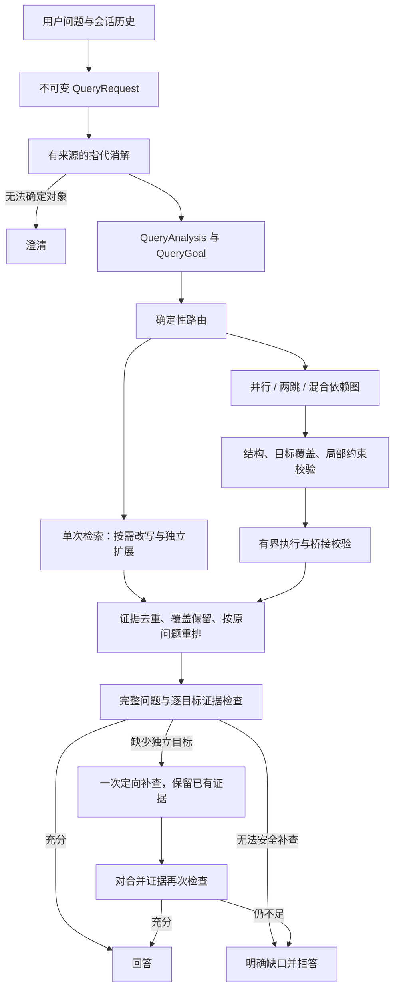

# 查询理解与执行管线（query-v5）

本轮改造把用户需求、语义目标、执行计划和证据判定拆成不同契约。工业化目标是：每次变换可追踪，子查询不丢条件，失败不丢已有证据，调用有预算，最终回答覆盖完整需求，并能通过真实 Agent 路径评测。

## 运行流程



Agent 的 `query` 只作为工具调用的检索提议和诊断信息；KB 管线以服务端绑定的原问题为准。它不能替换用户问题、用户身份或历史。多轮提议不会反复消解同一个指代或重新规划同一个原问题；缓存只在当前请求内生效。补查由目标和证据缺口驱动。Agent 重复同一工具参数会复用结果并以 `no_progress` 停止。

## 契约和模块

| 模块 | 职责 |
| --- | --- |
| `query_contract.py` | 原问题、消解后问题、参考日期、上下文来源、原文约束位置、稳定目标 ID |
| `query_grounding.py` | 检查目标约束是否增加原问题没有的明确条件；原文片段保留引文和位置 |
| `query_intent.py` | 语言特征、任务类型、目标列表、依赖和同次检索覆盖可能性；规则只能在明确场景提前返回 |
| `query_semantics.py` / `conf/query_domain.json` | 可版本化同义词、指标口径、比较方向和精确条件保护 |
| `query_validation.py` | 来源分句、目标局部约束、实体/指标/时间绑定和未知图表关系检查 |
| `query_rewrite.py` / `query_expansion.py` | 分别负责规范化与召回扩展；改写未发生也可扩展；失败回到可信输入 |
| `query_planning.py` | 路由与执行计划分离；校验节点、目标、模板、槽位、依赖和约束 |
| `query_execution.py` | 拓扑分层执行混合依赖图，保留成功分支和桥接失败前证据 |
| `query_runtime.py` | 请求级预算、进程级线程池与队列、模型调用记录、上下文传递 |
| `retrieval.py` | 集成执行、统一排序、目标补查与最终门控；保留门控前快照 |
| `derived_evidence.py` | 从已绑定表格生成带单元格出处的确定性计算证据 |
| `sequential_retrieval.py` | 从原文提取桥接值及来源；评级要绑定具体公司，冲突时放弃绑定 |
| `agent_evaluation.py` | 无数据库写入的真实 Agent → KB 工具 → 回答评测适配器 |

`QueryGoal.constraints` 保存按目标归属的约束；`source_spans` 必须逐字引用原文。服务端生成的 `constraint_provenance` 记录原值、规范化值，以及能在原问题中找到的原文引文和位置。原文中的片段直接接受，例如“贵不贵”或“贵”；改写过的约束允许使用不同说法，但不能新增公司、年份、数字等明确条件。主体、时间、指标等关系仍会检查，防止把已有年份或指标错绑到别处。只有上下文唯一时才解析“同期”。既有 `intent`、`language_features`、`task_types`、`need_expansion` 字段保持兼容。

不合格式但唯一的模型目标 ID 由服务端映射成合法 ID，并同步改写依赖引用；重复 ID、未知依赖和循环仍拒绝。有效目标清单中的数量和依赖是路由信号的依据，不因 `target_count=1, targets_independent=true` 这类冗余信号不一致而丢弃目标。映射及信号变化记录在 `normalization` 事件中。

规划最多 8 个节点，支持 `single`、`parallel`、`sequential`、`graph`、`clarify`。`sequential` 保留原来的两跳执行器；`graph` 支持独立目标和依赖目标混合。执行前拒绝循环、未知依赖、重复节点/槽位、非法格式模板、遗漏目标和适用约束。查询分析和规划各最多允许一次带校验原因的模型纠正，使用同一个请求预算；网络异常不触发此纠正。输出截断时，第二次调用可提高输出 token 上限，最高 4096。

有效独立目标优先直接编译为并行查询，并通过完整结构和语义校验，`source=rule` 且没有 `fallback_reason`。只有编译失败才请求模型生成计划，不再为每次并行查询固定多调用一次模型。模型仍失败后不重复相同的失败编译。依赖目标必须提供真实槽位；无法生成合格计划时回退原问题单次检索。带输出槽位的排名查询若仅缺少已验证目标的“最高/最多”等选择条件，服务端补入该条件，桥接仍须从证据取值，不能预设获胜类别。没有把“未来三年”等相对时间自动展开为具体年份。

关系检查在分析和规划阶段都执行。对于“图2和图3中，哪张图对应某事实”，目标必须保留待求关系，不能按提及顺序提前指定图号；还检查显式主体与年份、指标与报告期、固定图号与指标，以及光伏等业务范围的归属。这些是有边界的确定性检查，并非通用自然语言关系推理器。原问题与自身的保真校验必须通过；组织提取先隔离时间文本，不通过删去名称中间的时间来拼造实体。

对于明确列出 2–8 个图表候选的未知对应关系，规则保留一个完整关系目标和 `candidate_locators`，为每个候选编译读取节点，不向节点预填待求事实。最终合并优先保留各候选图表命中的证据，充分性校验仍检查完整原问题；缺少候选时只补查未覆盖的图表定位，并保留共享主体范围。不能仅凭“已取回两个标题”视为关系已经解答。

同义词表只应收录经业务确认的等价表达。基本/稀释每股收益、净利润/归母净利润、实际/预测、累计/新增、金额/费用率不应相互替换。确定性保护也检查正负号、比较符和显式比较方向。当前实体识别以中文组织、引号、少量人名/地点模式为主，不是通用 NER 或完整语义等价证明。

指代消解只接受带历史原文和消息索引的替换绑定，不接受模型改写整个问题。助手独自提出、用户从未提供的实体不会直接成为硬事实。信息不足返回澄清；这属于保守策略，可能增加澄清率，应在真实会话集上评估。

## 证据闭环与失败行为

- 独立节点并发，后继等依赖完成才执行。父节点失败或没有可靠桥接值，只阻断其后继，已完成兄弟节点仍保留。
- 需要继承文档范围时，必须取得明确的同一文档 ID；缺失或冲突时阻断，不扩大范围。
- 模型必须逐目标报告 `supported`、`missing` 或 `conflict`，并给出有效来源索引。目标缺失、重复 ID、越界索引、总判定和目标判定矛盾均视为校验失败。
- 缺少独立目标时最多补查一轮。保留已支持证据，合并新候选后重新检查完整问题；没有新证据立即停止。依赖子图的自动重规划尚未实现，不能把未取得的桥接值当作已知事实补查。
- 校验器故障默认拒答，不把故障误判为缺少某项事实并无限重试。`RAG_EVIDENCE_SUFFICIENCY_FAIL_OPEN=true` 或关闭门控会改变这一保证。
- 超时、连接错误、HTTP 408/5xx 最多重试一次，仍受原请求期限与模型调用预算约束；格式或语义错误不按网络故障重试。失败保留 `verification_status=unavailable`、`failure_kind`、`failure`、`attempts`，回答文案区分“未完成核验”和“资料不足”。
- 计算结果无需在文档中原样出现。白名单计算当前覆盖同一期间的每股派息率，以及显式两期同一指标的差值、增幅/降幅；使用 `Decimal`，不执行模型表达式。输入必须来自可靠绑定的表头和单元格，检查文档范围、时间、单位、冲突及分母。派息率可以使用同一表内、未标出不同单位的两项每股指标作为共同计量基础，并记录 `unit_basis`；不跨文档猜币种或做未经支持的换算。
- `derived_evidence` 保存输入单元格、公式操作、结果和来源 chunk；门控使用时返回 `derived_evidence_ids`。不支持或输入不足的自动计算记录 `unresolved`，不自动拒答；计算成功也不替代其他事实、关系及目标的充分性检查。
- Agent 合并多次 KB 调用或其他工具结果时，再检查整个证据集合；会话临时文档也参与这一检查。充分性失败时不调用回答模型。最终判定会传给评测结果。

## 预算、并发和回滚

默认值见 `backend/.env.example`：

| 配置 | 默认值 | 含义 |
| --- | --- | --- |
| `RAG_QUERY_DEADLINE_SECONDS` | 45 | 当前请求的规划与 KB 检索期限 |
| `RAG_QUERY_MAX_MODEL_CALLS` | 16 | Agent 规划、消解、意图、规划、改写、扩展、桥接、校验共享次数 |
| `RAG_QUERY_MAX_RETRIEVALS` | 12 | 各节点和补查共享的逻辑检索次数，缓存命中不消耗 |
| `RAG_QUERY_CONCURRENCY` | 3 | 单次请求同一波的最大并发数 |
| `RAG_QUERY_WORKERS` | 8 | 单进程共享线程池大小；提交槽位限制为两倍线程数 |
| `RAG_QUERY_GRAPH_ENABLED` | true | 关闭后混合依赖图回退原问题检索 |
| `RAG_QUERY_REPAIR_ENABLED` | true | 允许一次缺失独立目标补查 |
| `RAG_EVIDENCE_SUFFICIENCY_TRANSIENT_RETRY` | true | 允许一次预算内的证据校验网络故障重试 |

关闭并行或递进检索也会关闭依赖这些能力的混合图。`QUERY_REWRITE_ENABLED` 和 `QUERY_EXPANSION_ENABLED` 各自独立；无变换基线需要同时设为 `false`。本地 embedding/reranker 推理在进程内串行，避免并发冷启动和放大模型内存；远程推理和 ES 请求使用剩余期限。

期限是协作式的：停止调度新工作，限制网络超时，取消尚未开始的任务；无法强制中断已经运行的本地推理。线程池及队列是每进程限制，不是跨副本配额。最终回答流、Web 工具和离线 judge 不在上述 KB 预算内；embedding/reranker 调用不计入 LLM 次数。缓存不跨请求或租户共享。跨服务熔断、分布式限流和流式回答取消需在部署层继续建设。

## 诊断和验收

原始检索及工具诊断包含 `query_contract`、`query_intent`、`retrieval_route`、`retrieval_plan`、`plan_execution`、`query_transform`、`retrieval_graph`、`query_repair`、`query_runtime`。原文、证据引用和上下文引文可能包含业务数据，持久化这些诊断时应遵循项目的数据保留与访问控制策略。

`query_runtime` 提供策略版本、预算、调用次数、剩余时间、阶段状态、耗时及服务商返回的 token 用量。token 缺失保持未知；不将缺失视为零成本。`total` 是实际经过时间，并发节点召回/重排字段是各节点耗时之和，不能相加推算总延迟。`repair` 包含补查和再次门控。`stage_latency_semantics` 显式记录这种区别。

### 阶段状态与失败定位

`query_runtime.observability_version=1.0`。`trace_id` 标识共享运行上下文，`pipeline_id` 区分同一 Agent 请求内的多次 KB 管线调用；`event_id` 与 `elapsed_ms` 给出事件顺序和相对时间。分析/规划的模型纠正共享 `operation_id`，使用 `attempt=1/2` 区分；计划执行使用 `execution_id`，节点用 `node_id`、`goal_ids` 关联检索及桥接调用。

| phase | 成功意味着什么 | 失败或未执行的记录 |
| --- | --- | --- |
| `request` | 服务商调用返回，状态 `ok`；不代表内容可用 | `error` 表示已发出调用后失败；`blocked`、`request_sent=false` 表示预算或本地准备阻止调用 |
| `parse` | JSON 解码、字段类型/枚举/长度和对象构造通过，状态 `accepted` | `rejected` 包含字段路径或 JSON 行列；上游请求失败则为 `skipped` |
| `semantic_validation` | 目标覆盖、来源、约束绑定、模板及依赖关系通过，状态 `accepted` | `rejected` 表示内容不符合契约；解析未通过则为 `skipped`，不能统计成语义失败 |
| `execution` | 当前执行尝试的所有节点完成，状态 `succeeded` | `partial`、`failed`、`skipped` 分别表示部分完成、失败、功能关闭或需澄清 |

请求事件覆盖使用 `model_completion` 的模型调用；独立的解析/语义事件接入查询理解、查询规划和证据充分性校验，规则计划编译与模型响应按 `source` 分组。其他模型阶段不能根据请求 `ok` 推断解析或语义成功。规则快速返回和缓存命中不伪造模型请求、解析或校验成功。

诊断保留 `error_type`、稳定 `rule`、`failure_fields`、可用的 `node_id/goal_id`、`detail`、`finish_reason` 和 `end_reason`。失败详情最多 500 字符，失败响应片段最多 2000 字符；`response_chars` 和 `response_excerpt_truncated` 说明片段是否截短。服务商 `finish_reason=length` 表示模型输出触及 token 限额，和日志片段截短是两回事。语义失败示例：

```json
{
  "stage": "query_planning_validation",
  "phase": "semantic_validation",
  "status": "rejected",
  "source": "model",
  "attempt": 1,
  "rule": "goal_local_constraint_dropped",
  "failure_fields": ["subqueries[].query"],
  "node_id": "revenue_lookup",
  "finish_reason": "stop",
  "end_reason": "validation_failed"
}
```

一次模型纠正结束后，`*_completion` 标明 `accepted`、`accepted_after_repair`、`repair_exhausted`、`request_failed` 或 `budget_exhausted`。规则编译的解析/校验使用 `source=rule`，编译拒绝记录 `query_planning_compile`，最终单查询降级记录 `query_planning_fallback`。纠正提示包含结构化的字段路径、规则和可用的预期值/实际值/原文上下文，不只传异常名称。最终分析回退仍在 `query_intent.validation_error` 保留兼容信息。

`plan_execution` 同时记录请求路线、最终计划模式、实际执行模式和全部尝试。`requested_plan_execution_success` 表示请求路线的计划是否完成，`plan_execution_success` 表示最终选定计划的第一次执行是否完成，`final_execution_success` 表示最后一次执行是否完成；关闭执行时可以为 `null`。例如并行失败后单查询成功，前者不会被记成成功。`fallback_applied` 表示计划降级或执行回退；仍保持并行的规则编译通过 `retrieval_plan.source=rule` 和 `fallback_reason` 识别。

节点诊断区分 `succeeded`、`empty`、`failed`、`budget_exhausted`、`blocked` 和 `unresolved_bridge`。检索成功但返回空结果属于执行完成，是否足以回答由后续证据门控单独判定；缺少桥接值会标出被阻断的后继。依赖图/并行/递进/单查询使用同一套执行事件。补查尝试的停止原因保存在 `query_repair`，初次门控决定保留一条事件，最终决定保存在 `evidence_sufficiency`；这些结构化结果不重复写成事件。

`query_pipeline` 保存最终结束原因：澄清、预算耗尽、校验不可用、证据不足、有证据返回、空结果或未处理异常。快照在结束事件之后取得；异常退出时将快照附在原异常的 `query_runtime` 上。

`retrieval_fusion.candidate_diagnostics` 保存候选 chunk ID、各召回分支名次、RRF 名次、重排名次、冲突数、是否入选及淘汰原因，最多 200 项并附截断标记。并行合并另保留覆盖预留和最终选择诊断。它解释本次实际召回候选的流向，不等于对未进入任何召回分支的文档做全库扫描。

评测结果无需额外开关：逐题的 `retrieval.query_runtime.events` 保留请求、解析、语义校验和执行事件，`retrieval.plan_execution` 保留执行摘要。汇总的 `query_metrics.pipeline_end_reasons` 统计管线终止原因。预算阻止的模型调用不会计入已发出请求或 token 用量；解析/校验事件也不重复计费。

检索和端到端汇总的 `query_metrics` 提供计划回退率、标注路由一致率、目标支持率、补查成功率、模型/检索调用与 token 覆盖统计，所有指标保留分母。路由一致不等于答案正确，应结合原有证据覆盖、拒答、引用和忠实度指标判断。总延迟增加 P99；成功查询的延迟分布需与错误率一起查看。

新增 `analysis_sources/analysis_fallback_rate`、`requested_plan_execution_success_rate`、`verification_unavailable_count`；`repair_cohorts` 分别报告可回答与不可回答样本的补查次数和成功率，避免将不可回答样本的正确拒答解释成修复失败。本轮未修改评测金标，也未执行测试、评测或线上模型调用；静态检查不能证明指标已经改善。

从 `backend` 运行不依赖线上模型的回归：

```bash
docker compose -f docker-compose.test.yml run --rm --no-deps -T test_runner \
  pytest -q -p no:cacheprovider -m unit
```

全部测试还需要 Compose 的独立 `gsk_pg_test` 服务；测试夹具拒绝连接名称不是 `gsk_test` 的数据库。回归覆盖实体/时间归属、正负号、比较方向、指标口径、伪造上下文、非法依赖图、桥接归属与冲突、并发、预算、缺口补查，以及模型工具参数不能覆盖原问题。

真实模型验收使用 `evals/run_e2e_eval.py --execution-mode agent`，默认 `grounded` 模式仍可作直接检索对照。二者固定 KB-only，防止外网答案污染知识库不可回答题。样本可带 `conversation_history`；`expected_behavior` 支持 `answer`、`refuse`、`clarify`。新增测试验证了执行契约和故障处理，不代表已经测得真实语料的召回率或线上时延提升。

上线前应冻结语料、模型版本和策略版本，分别在 dev/test/challenge 上比较：多目标完整证据覆盖、错误放行/误拒、澄清准确率、计划回退、P95/P99、请求成本和并发故障率。现有金融词表和小规模离线集不足以证明跨领域泛化；需补真实会话、未见实体、长问题、依赖链和服务降级样本。未校准的模型自报置信度不作为可靠路由依据。
